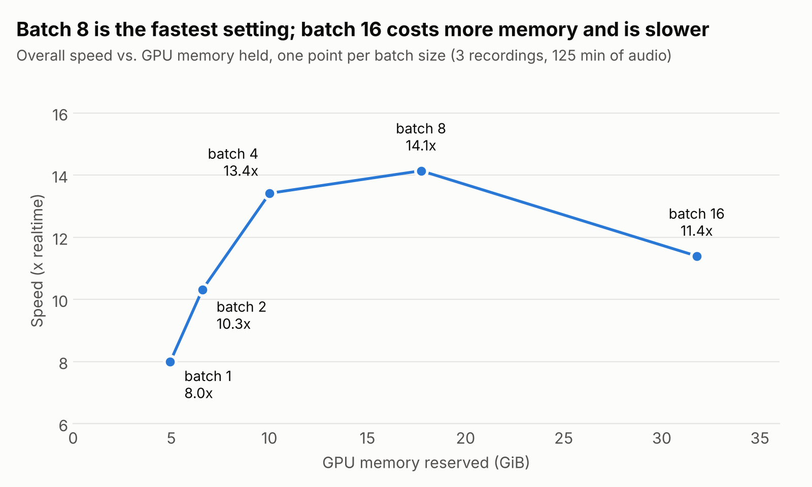
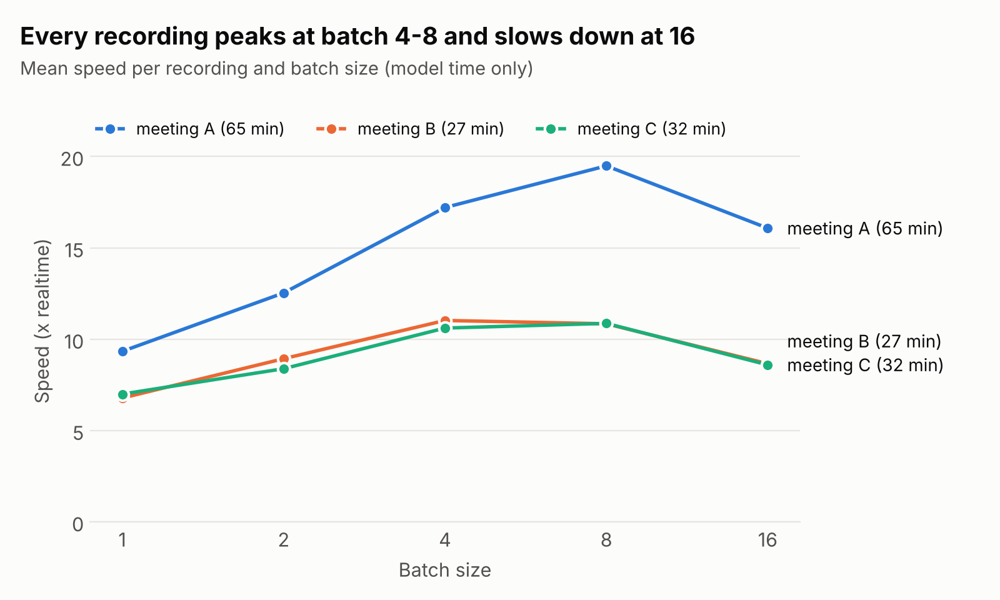
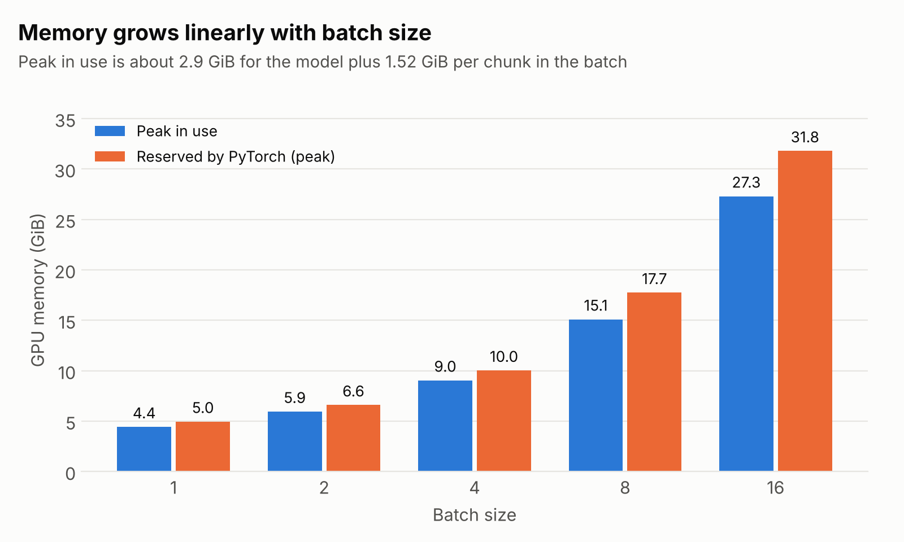

# Whisper large-v3 batch-size benchmark

How much GPU memory does batched Whisper inference really need, and how much speed does it buy?

I ran `openai/whisper-large-v3` (fp16, Hugging Face `transformers` pipeline, served with FastAPI) on an NVIDIA RTX 6000-class GPU and measured speed, VRAM and GPU utilisation at batch sizes 1 to 16 on 125 minutes of real meeting audio.

**Result: the largest batch was not the fastest.** Batch 16 used 32 GiB and was 24% slower than batch 8. Batch 4 came within 5% of the best speed using 10 GiB.



## Why I ran this

The service was running at batch 16 and holding about 34 GB of VRAM on a card it shares with an LLM server. The assumption was that this memory was the price of speed, and that lowering the batch size would slow transcription down. A few manual runs suggested otherwise, so I built a benchmark to measure it properly.

## Results

All figures are means over the successful runs. Speed is audio length divided by model time, so 14x means one hour of audio takes about 4 minutes 15 seconds.

| Batch size | Speed (x realtime) | Time vs fastest | VRAM peak (GiB) | VRAM reserved (GiB) | GPU utilisation | Tokens/s |
|---:|---:|---:|---:|---:|---:|---:|
| 1  | 8.0  | +77%    | 4.4  | 5.0  | 40% | 25.5 |
| 2  | 10.3 | +37%    | 5.9  | 6.6  | 51% | 32.8 |
| 4  | 13.4 | +5%     | 9.0  | 10.0 | 60% | 42.6 |
| **8**  | **14.1** | **fastest** | 15.1 | 17.7 | 74% | 45.5 |
| 16 | 11.4 | +24%    | 27.3 | 31.8 | 81% | 36.8 |

### What the data shows

1. **Batching helps up to 4, barely helps at 8, and hurts at 16.** Going from 1 to 4 cuts total time by 40%. Going from 4 to 8 gains another 5%. Going from 8 to 16 loses 24%.
2. **Memory is linear and predictable.** Peak usage fits `2.9 GiB + 1.52 GiB x batch_size` at all five settings, and was identical for every recording and every repeat. Recording length does not matter once it is long enough to fill a batch.
3. **The pattern holds for every recording.** All three peak at batch 4 or 8 and drop at 16, although their absolute speeds differ by almost 2x.
4. **Higher GPU utilisation did not mean higher throughput.** Utilisation rose steadily from 40% to 81%, while throughput peaked at batch 8 and then fell.
5. **Timings are stable.** The spread between repeats (standard deviation / mean) was 3% or less for every recording and batch size.





### Per recording

Mean model time in seconds (speed in brackets).

| Recording | Audio | Batch 1 | Batch 2 | Batch 4 | Batch 8 | Batch 16 |
|---|---:|---:|---:|---:|---:|---:|
| Meeting A | 65.4 min | 420 (9.3x) | 313 (12.5x) | 228 (17.2x) | **201 (19.5x)** | 244 (16.1x) |
| Meeting B | 27.1 min | 240 (6.8x) | 182 (8.9x) | **147 (11.0x)** | 150 (10.8x) | 188 (8.7x) |
| Meeting C | 32.4 min | 277 (7.0x) | 231 (8.4x) | 183 (10.6x) | **179 (10.9x)** | 226 (8.6x) |

### Batch size changes the transcript

For a given batch size, the three repeats produced the same token, character and segment counts every time, and the batch 1 repeats were character-for-character identical. Across batch sizes the text differs:

| Character similarity to the batch 1 transcript | Batch 2 | Batch 4 | Batch 8 | Batch 16 |
|---|---:|---:|---:|---:|
| Meeting A | 94.0% | 93.1% | 93.1% | 93.5% |
| Meeting B | 90.1% | 75.5% | 90.8% | 85.8% |
| Meeting C | 91.5% | 95.0% | 91.9% | 92.6% |

There is no reference transcript for these recordings, so this shows that the outputs differ, not which one is more accurate. Anyone choosing a batch size for production should check quality as well as speed.

### Choosing a setting

| Situation | Batch size | Why |
|---|---:|---|
| GPU shared with other workloads | 4 | 95% of the best speed for 10 GiB instead of 18 GiB |
| GPU dedicated to Whisper | 8 | Fastest measured |
| Very tight memory | 1 or 2 | 5 to 7 GiB, at 37% to 77% more time |
| Any | not 16 | Slower than 4 and 8, and three times the memory of 4 |

## Open questions

These are things the benchmark surfaced but does not explain.

- **Why batch 16 is slower.** Two untested hypotheses: each batch keeps decoding until its longest chunk finishes, so larger batches spend more steps on chunks that are already done; and the per-chunk memory cost (1.5 GiB) is high enough that memory traffic may dominate.
- **Why 1.5 GiB per chunk.** This is more than the model's size suggests. The attention implementation (eager vs SDPA) is the first thing to test.
- **Why Meeting A runs almost twice as fast as B and C.** Output tokens per chunk differ by less than that (55 vs 68 and 80), so token count alone does not explain it.

## Method

- **Model:** `openai/whisper-large-v3`, `torch.float16`, `transformers` ASR pipeline with `chunk_length_s=30` and `return_timestamps=True`.
- **Serving:** FastAPI, one process, one transcription at a time. Batch size is passed per request, so the model is loaded once for the whole benchmark.
- **Audio:** three Japanese meeting recordings of 27, 32 and 65 minutes.
- **Design:** 3 recordings x 5 batch sizes x 3 repeats. Runs are interleaved (repeat, then recording, then batch size) so a slow period on the machine is spread across all settings instead of penalising one.
- **Timing:** model time only, measured inside the server around the pipeline call. Upload, audio decoding and queueing are recorded separately and excluded.
- **Memory:** `torch.cuda.max_memory_allocated` (peak) and `max_memory_reserved` (reserved). The cache is emptied and the counters reset before every request, so each figure belongs to one run. Units are GiB (1024^3 bytes). `nvidia-smi` reports a few hundred MiB more because it includes the CUDA context.
- **GPU utilisation:** sampled once per second with `nvidia-smi` during inference. It covers the whole card, so no other workload was running.
- **Tokens:** text tokens in the final transcript. Timestamp tokens and text generated twice in overlapping chunk edges are not counted.
- **Similarity:** normalised Levenshtein similarity (`rapidfuzz`) against the first batch 1 transcript of the same recording.

### Environment

Fill these in from `python scripts/collect_env.py` on the benchmark machine.

|               |                                                                         |
| ------------- | ----------------------------------------------------------------------- |
| GPU           | **NVIDIA RTX PRO 6000 Blackwell Workstation Edition — 96 GB GDDR7 ECC** |
| Driver / CUDA | **NVIDIA Driver 595.71.05 / CUDA 13.2**                                 |
| PyTorch       | **2.13.0 + CUDA 13.2**                                                  |
| transformers  | **4.57.x**                                                              |
| OS / Python   | **Ubuntu 24.04 LTS / Python 3.12**                                      |


## Limitations

- **Small sample:** three recordings, one language, one type of content (meetings).
- **One configuration:** one GPU, one backend, default attention settings. faster-whisper, SDPA attention and the model's native long-form `generate` were not tested and may behave differently.
- **No accuracy measurement:** there is no reference transcript, so word error rate is not reported.
- **Three lost runs:** 42 of 45 runs completed. The server was restarted by mistake during the third repeat, so three recording and batch-size combinations have two repeats instead of three. They are listed as failed in `runs.csv` and excluded from the averages.
- **Chunk count is estimated** from the audio length and the pipeline's default stride, not read from the pipeline.

## Reproduce

```bash
# 1. Server (on the GPU machine)
pip install -r requirements-server.txt
WHISPER_MODEL=openai/whisper-large-v3 python server/whisper_server.py

# 2. Benchmark (from any machine that can reach the server)
pip install -r requirements-bench.txt
python benchmark/bench_whisper.py --folder test_folder --url http://<server>:8788 \
    --batch-sizes 1,2,4,8,16 --repeats 3 --language ja

# 3. Tables and charts
python analysis/analyze.py bench_results/<timestamp>/runs.csv --assets assets
```

Put your own audio or video files in `test_folder/`. Useful server settings are environment variables: `GPU_PREFERENCE`, `MIN_FREE_GPU_MB`, `BATCH_SIZE` (default when a request does not specify one) and `MAX_BATCH_SIZE`.

## Repository layout

```
server/whisper_server.py      FastAPI service: per-request batch size, per-request metrics
benchmark/bench_whisper.py    Sends every file at every batch size, writes runs.csv
analysis/analyze.py           Rebuilds summary.csv, overall.csv and the charts from runs.csv
scripts/collect_env.py        Prints hardware and library versions
results/2026-10-08/           Raw and summarised data behind this README
assets/                       Charts
```

## Data

The recordings are private and are not in this repository, and neither are the transcripts. File names in `results/` are replaced with `meeting_A`, `meeting_B` and `meeting_C`. All measurements are unchanged.